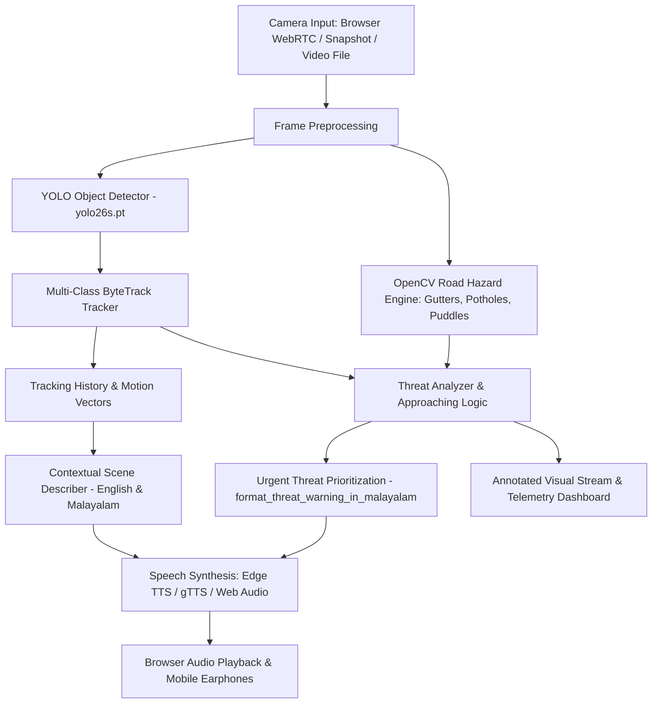

# BlindAssist: AI-Powered Vision Assistance for the Visually Impaired

[](https://python.org)
[](https://streamlit.io)
[](https://github.com/ultralytics/ultralytics)
[](https://github.com/ifzhang/ByteTrack)
[-purple)](#voice-assistance)

**BlindAssist** is an intelligent assistive computer vision system engineered to aid visually impaired pedestrians navigating complex indoor and outdoor road environments. It provides real-time obstacle detection, multi-object trajectory tracking, apparent approach velocity estimation, ground-level road hazard identification (such as open gutters and potholes), and spoken audio warnings in **Malayalam** and **English**.

The project features both:
1. **Interactive Streamlit Cloud & Mobile Web Application (`app.py`)**: Accessible from any modern desktop or Android mobile browser with real-time WebRTC streaming, snapshot camera capture, video analysis, and audio synthesis.
2. **Original Desktop Real-Time Pipeline (`main.py`)**: Local OpenCV / Tkinter desktop interface for direct camera and video inputs.

---

## 🌟 Key Features

- **Real-Time Object Detection**: Powered by a lightweight YOLO model (`yolo26s.pt` / `yolov8s.pt`) detecting 80 standard COCO classes (pedestrians, vehicles, chairs, stairs, bicycles, doors, etc.).
- **Multi-Class ByteTrack Tracking**: Associates detected bounding boxes across successive video frames using Kalman filtering to track trajectories and distinguish newly entered obstacles.
- **Dynamic Approach & Velocity Assessment**: Calculates bounding box growth rates over time intervals to distinguish static obstacles from rapidly approaching collision threats (e.g., oncoming cars or bikes).
- **Kerala Road Hazard Awareness**:
  - **Open Gutters / Canals (*ഓടകൾ*)**: High-priority boundary monitoring along road shoulders to prevent critical falls.
  - **Potholes (*കുഴികൾ*)**: Surface depression detection in the walking corridor to alert pedestrians to tripping hazards.
  - **Water Puddles (*വെള്ളക്കെട്ടുകൾ*)**: Specular reflection analysis identifying slippery waterlogged road patches.
- **Offline Malayalam Scene Description**: Translates detected object counts, spatial zones (*ഇടതുവശത്ത്*, *മധ്യത്തിൽ*, *വലതുവശത്ത്*), and lateral motion vectors into natural Malayalam phrasing without requiring external translation APIs.
- **Dual-Engine Voice Synthesis**: Generates clear spoken Malayalam alerts using Microsoft Edge Neural TTS (`ml-IN-MidhunNeural`) with automated `gTTS` fallback and disk caching.
- **Accessible Dark Navy Theme**: High-contrast, WCAG-conscious visual design with clear indicators and responsive layout for mobile browsers.

---

## 🏗️ System Architecture



---

## 📁 Repository Structure

```
BlindAssist/
├── app.py                     # Streamlit Web Application entry point
├── main.py                    # Original desktop OpenCV/Tkinter pipeline
├── bytetrack_wrapper.py       # Multi-class ByteTracker wrapper
├── byte_track.py              # ByteTrack core tracking algorithm & Kalman filter
├── yolo26s.pt                 # Trained YOLO small model weights (approx 20.4MB)
├── test.jpg                   # Sample test image for quick evaluation
├── requirements.txt           # Python dependencies
├── packages.txt               # Linux system dependencies (libgl1, libglib, ffmpeg)
├── .env.example               # Environment variables template
├── .gitignore                 # Standard exclusions for temporary caches & venvs
├── .streamlit/
│   └── config.toml            # Streamlit theme & server configuration
├── Data/
│   ├── audio_cache/           # Cached synthesized speech MP3 files
│   └── Person_walking_...mp4  # Built-in sample road footage
├── modules/
│   ├── __init__.py
│   ├── detector.py            # YOLO detector with relative path resolution
│   ├── camera.py              # Desktop OpenCV VideoCapture & YouTube stream wrapper
│   ├── threat_analyzer.py     # Hazard priority, approaching velocity & road surface detection
│   ├── malayalam.py           # Offline Malayalam scene describer & warning formatter
│   ├── speaker.py             # Dual-engine TTS with web audio bytes generation
│   ├── pipeline.py            # Unified frame processing, drawing & WebRTC processor
│   ├── ai_engine.py           # Priority-based English message generator
│   ├── memory.py              # Object cooldown memory
│   └── qwen_vision.py         # Optional Ollama VLM scene description
└── tests/
    ├── test_threat_analyzer.py
    ├── test_malayalam.py
    ├── test_speaker.py
    └── test_pipeline.py
```

---

## 🚀 Local Installation & Quick Start

### 1. Prerequisites
- Python 3.10, 3.11, or 3.12 installed.
- Git installed.

### 2. Clone the Repository
```bash
git clone https://github.com/<your-username>/BlindAssist.git
cd BlindAssist
```

### 3. Create and Activate a Virtual Environment
- **Windows (Command Prompt / PowerShell)**:
  ```powershell
  python -m venv venv
  .\venv\Scripts\activate
  ```
- **macOS / Linux**:
  ```bash
  python3 -m venv venv
  source venv/bin/activate
  ```

### 4. Install Dependencies
```bash
pip install -r requirements.txt
```

### 5. Run the Streamlit Web Application
```bash
streamlit run app.py
```
Open your browser and navigate to `http://localhost:8501`.

### 6. Run Unit Tests
To verify all detection, tracking, threat analysis, and Malayalam formatting logic:
```bash
python -m unittest discover tests
```

### 7. Run Original Desktop Pipeline (Optional)
```bash
python main.py
```

---

## ☁️ Cloud Deployment Guide

BlindAssist is pre-configured for instant zero-configuration deployment to **Streamlit Community Cloud** or **Hugging Face Spaces**.

### Option A: Streamlit Community Cloud (Recommended)

1. **Push your code to GitHub**:
   ```bash
   git init
   git add .
   git commit -m "Initial commit for BlindAssist Streamlit App"
   git branch -M main
   git remote add origin https://github.com/<your-username>/BlindAssist.git
   git push -u origin main
   ```
   *(Note: Ensure `yolo26s.pt` is committed. Since it is ~20.4MB, it fits well within GitHub's standard 100MB file limit).*

2. **Connect to Streamlit Cloud**:
   - Go to [share.streamlit.io](https://share.streamlit.io/) and sign in with your GitHub account.
   - Click **New app**.
   - Select your repository: `<your-username>/BlindAssist`.
   - Set **Branch**: `main`.
   - Set **Main file path**: `app.py`.
   - Click **Deploy**.

3. **Automatic System Dependency Handling**:
   - Streamlit Cloud automatically reads `packages.txt` and installs `libgl1`, `libglib2.0-0`, and `ffmpeg` for headless OpenCV support.
   - Streamlit Cloud reads `requirements.txt` and installs all necessary Python wheels.

4. **Public Deployment URL**:
   - Upon completion, Streamlit Cloud provisions a public URL (e.g., `https://blindassist.streamlit.app`).

---

### Option B: Hugging Face Spaces

1. Create a new Space on [Hugging Face](https://huggingface.co/new-space).
2. Select **Streamlit** as the Space SDK.
3. Push the repository files to the Hugging Face Space repository.
4. The application will build and launch automatically.

---

## 📱 Mobile Browser Testing & Compatibility

BlindAssist is designed to run directly on smartphone mobile browsers without requiring terminal commands or installing Python on the phone:

| Feature | Android Browser (Chrome, Firefox, Edge) | iOS Browser (Safari, Chrome) | Desktop Browser |
| :--- | :---: | :---: | :---: |
| **Snapshot / Mobile Camera Mode** | ✅ Fully Supported | ✅ Supported | ✅ Supported |
| **WebRTC Continuous Live Stream** | ✅ Supported (with camera permission) | ⚠️ May require STUN/TURN | ✅ Supported |
| **Video File Analysis & Download** | ✅ Supported | ✅ Supported | ✅ Supported |
| **Audio Voice Output** | ✅ Audio player / Earphones | ✅ Audio player (requires user tap) | ✅ Autoplay / Audio player |
| **Object Detection Dashboard** | ✅ Responsive layout | ✅ Responsive layout | ✅ Wide layout |

### Testing on an Android Smartphone:
1. Open the public deployment URL (or your local network URL `http://<your-pc-ip>:8501`) on your mobile phone's Chrome browser.
2. Select **📸 Snapshot / Mobile Camera** from the navigation sidebar.
3. Grant camera permissions when prompted by Chrome.
4. Tap **Take Photo** to capture a frame in your walking path.
5. Review the annotated overlay, hazard warnings, and tap **Play** on the audio player to hear the Malayalam announcement through your phone speakers or connected Bluetooth earphones.

---

## 🛡️ Safety, Reliability & Limitations

- **Not a Certified Mobility Device**: BlindAssist is an exploratory assistive technology prototype. It is **not** a replacement for primary orientation and mobility tools such as a white cane or a trained guide dog.
- **Absence of Detections is NOT Proof of Safety**: Environmental conditions such as poor lighting, motion blur, direct sunlight glare, or lens occlusions can prevent hazards from being recognized. Visually impaired users must never assume an unflagged path is clear.
- **OpenCV Road Hazard Rules**: Ground-level surface hazard detection (gutters, potholes, puddles) utilizes edge gradients and morphology. These heuristics are sensitive to harsh road shadows and require ongoing validation.
- **Cloud Latency**: Live WebRTC video processing over cellular data depends on network bandwidth. In high-latency areas, the **Snapshot / Mobile Camera Mode** provides consistent, reliable performance.

---

## 📜 License & Credits

- **Object Detection**: Ultralytics YOLO.
- **Tracking**: ByteTrack (ByteDance / ifzhang).
- **Speech Synthesis**: Microsoft Edge Neural TTS & gTTS.
- Developed with care to advance agentic accessibility solutions.
